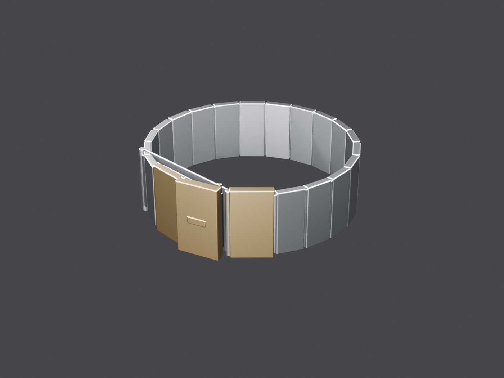
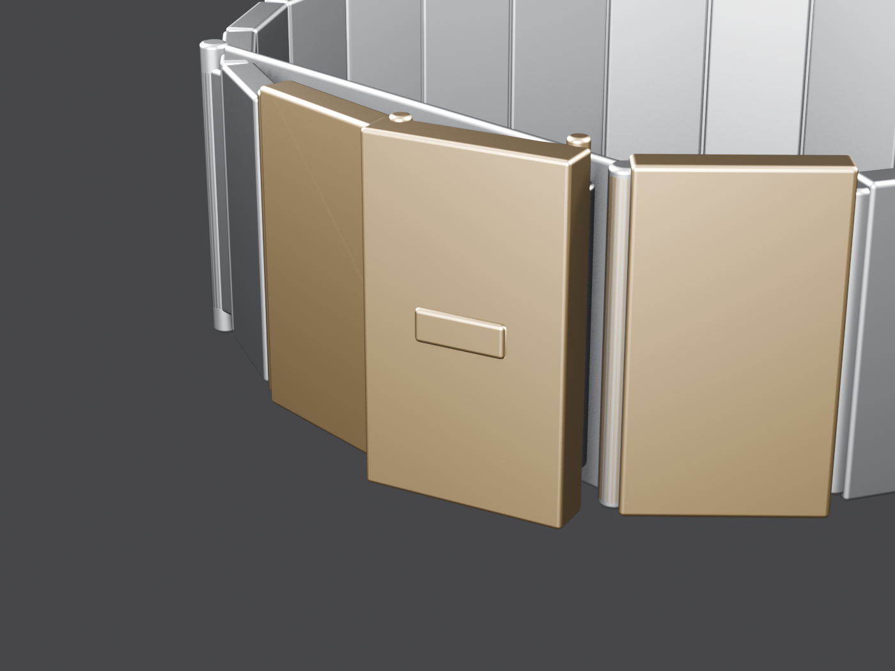
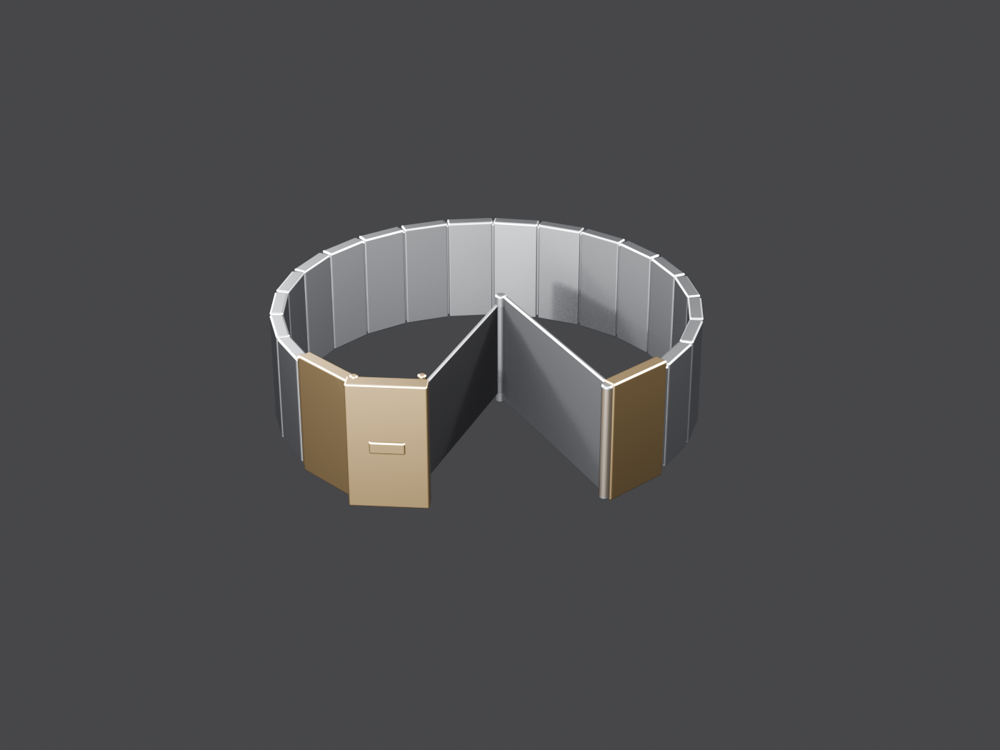

# ChainSmith

**Pivot-linked chains, bracelets and watch straps along a curve, with a physical rig and a fold-over clasp.**
For Blender 5.3+ · Free & open source (GPL-3.0-or-later)

> **0.2.0 beta.** Feedback and bug reports are welcome in [Issues](../../issues).



Model one link and mark where it joins its neighbours (its **pivots**). ChainSmith repeats it along a curve so every link's **End pivot meets the next link's Start pivot** exactly, even on tight bends. Then it behaves like the real thing:

| Feature | What it does |
|---|---|
| **Physical rig** | Links keep their exact length and joints never come apart, whatever you do to the curve. The curve is a guide: the chain follows it as far as the rig allows. |
| **Joint limits** | **Bend In / Bend Out** per joint. Ask for a tighter bend than the links allow and the chain leaves the curve instead of breaking. |
| **Fold-over clasp** | Body + inner blade + outer blade close the bracelet loop. It renders **closed** when the bracelet fits the curve, and **unfolds** when you make the curve bigger. |
| **Start / End caps** | Different first and last links, each with their own pivots, offset, rotation and scale. |
| **Copy Transform** | Per-link offset, rotation and scale, fixed or accumulated (90° accumulated roll = cable chain). Joints stay connected. |
| **Lock X / Y / Z** | Links ignore curve points moved along a locked axis. |

| Closed (close-up) | Open (curve scaled up 15%) |
|---|---|
|  |  |

## Install

### Drag & drop (recommended)

**Drag this link into any Blender 5.3+ window:**

[](https://github.com/hassanziah-byte/chainsmith/releases/download/v0.2.0-beta/chainsmith-0.2.0-beta.zip?repository=https%3A%2F%2Fgithub.com%2Fhassanziah-byte%2Fchainsmith%2Freleases%2Flatest%2Fdownload%2Findex.json&blender_version_min=5.3.0)

or this text link: **[ChainSmith 0.2.0 beta for Blender](https://github.com/hassanziah-byte/chainsmith/releases/download/v0.2.0-beta/chainsmith-0.2.0-beta.zip?repository=https%3A%2F%2Fgithub.com%2Fhassanziah-byte%2Fchainsmith%2Freleases%2Flatest%2Fdownload%2Findex.json&blender_version_min=5.3.0)**

> **First install: drag & drop twice.**
> 1. **First drop:** Blender asks to add the **ChainSmith repository** (and to allow online access if it's off). Accept it.
> 2. **Second drop:** drag the same link in again and click **Install**.
>
> After that, a single drop is enough.

Because the repository is added, Blender will **notify you of new versions**.

> Drag the link itself into Blender. Clicking it just downloads the zip, which you can then install manually (below).

### Manual install

1. Download `chainsmith-x.y.z.zip` from [**Releases**](../../releases/latest).
2. Drag the zip into Blender, or **Edit → Preferences → Get Extensions → ⌄ (top right) → Install from Disk…**
3. Manual installs don't get update notifications.

## Workflow

**Model your pieces with:** local **X** along the chain, local **Z** along the pins (bracelet width), **+Y** toward the wrist.

1. **Set the pivots on your link.** In Edit Mode select the vertices around a joint (e.g. the loop inside the link's hole) → right-click → **ChainSmith → Set Start Pivot**. Repeat for the other joint with **Set End Pivot**. The pivot is the *center* of the selection, so it can sit inside the geometry. Pivots are stored as the vertex groups `pivot_start` / `pivot_end` and move with the mesh.
   - Interlocking links (cable chains): put the pivot at the **inside end of the hole**, not the middle of the wire.
2. **Add the modifier.** Object Mode → **Add Modifier → Generate → ChainSmith**, pick a **Curve Object**.
3. Optional: **Start Cap / End Cap**, **Copy Transform**, **Lock X/Y/Z**, **Joint Limits**.
4. Optional: a **Clasp** to close the bracelet.

### Fold-over clasp

1. Keep the clasp parts **closed and assembled**, as worn. The rig reads the closed shape and the hinges from this pose.
2. On each part, set its two pins as pivots (**Set Start Pivot** on one pin, **Set End Pivot** on the other; the order doesn't matter):
   - **Body** (lock / logo plate): the pin the inner blade hinges on, and the pin of the start link.
   - **Inner Blade**: its two hinge pins.
   - **Outer Blade**: the end-link pin and the blade hinge.
3. Turn on **Clasp** and pick the three parts. The outer blade attaches to the last piece and the body to the first.
4. **Closed and open renders:** if the bracelet fits the curve it renders closed. Scale the curve up and the blades unfold to span the gap, up to **Clasp Open Limit** (1 = blades straight). Beyond that, the chain is pulled off the curve but stays connected.

Hide the source objects from render (link, caps, clasp parts): ChainSmith reads their geometry either way.

## Controls

| Control | What it does |
|---|---|
| **Count** | Number of links (caps not included) |
| **Measure Gap** | **Pivot to Pivot** (joints from pivots), **Edge to Edge** (bounding box), **Center to Center** (origin) |
| **Gap** | Extra space at every joint (negative = overlap) |
| **Start Offset** | Where the chain starts along the curve (start cap included) |
| **Lock X / Y / Z** | Links ignore curve points moved along that axis |
| **Show Pivots** | Viewport-only markers on every joint and clasp hinge |
| **Copy Transform** | Per-link offset / rotation / scale, fixed or **accumulated** |
| **Start Cap / End Cap** | Toggle panels: a different first/last link with its own pivots, offset, rotation and scale |
| **Clasp** | Toggle panel: fold-over clasp (Body, Inner Blade, Outer Blade); **Clasp Open Limit** caps how far it unfolds |
| **Joint Limits** | **Bend In / Bend Out** per joint; **Solver Iterations** (0 = plain layout along the curve) |

Closed curves wrap; on open curves the chain continues straight past the ends.

## Known limits (beta)

- Joint limits work in the bracelet's plane (the usual case). Strongly twisted 3D curves follow the curve but aren't limited out of plane.
- Links don't collide with each other or with the clasp.
- Butterfly (double-fold) clasp: planned. Lobster and hook clasps work as ordinary caps.

## Build & test

```sh
export BLENDER_EXE=/path/to/blender   # if blender is not on PATH
./run_blender.sh build_chainsmith.py -- "$PWD/extension/chainsmith.blend"
./release.sh                                          # dist/chainsmith-<version>.zip + index.json
./run_blender.sh tests/verify_chain.py -- "$PWD/extension/chainsmith.blend"
./run_blender.sh tests/verify_rig.py -- "$PWD/extension/chainsmith.blend"
./run_blender.sh tests/verify_extension.py -- "$PWD/dist/chainsmith-0.2.0-beta.zip"
./run_blender.sh tests/render_demo.py -- "$PWD/extension/chainsmith.blend" "$PWD/docs"
```

`run_blender.sh` runs Blender headless with an isolated profile so your Blender settings and extensions are never touched. `reference/rig_prototype.py` is the plain-Python prototype of the rig solver.

## License

GPL-3.0-or-later.
